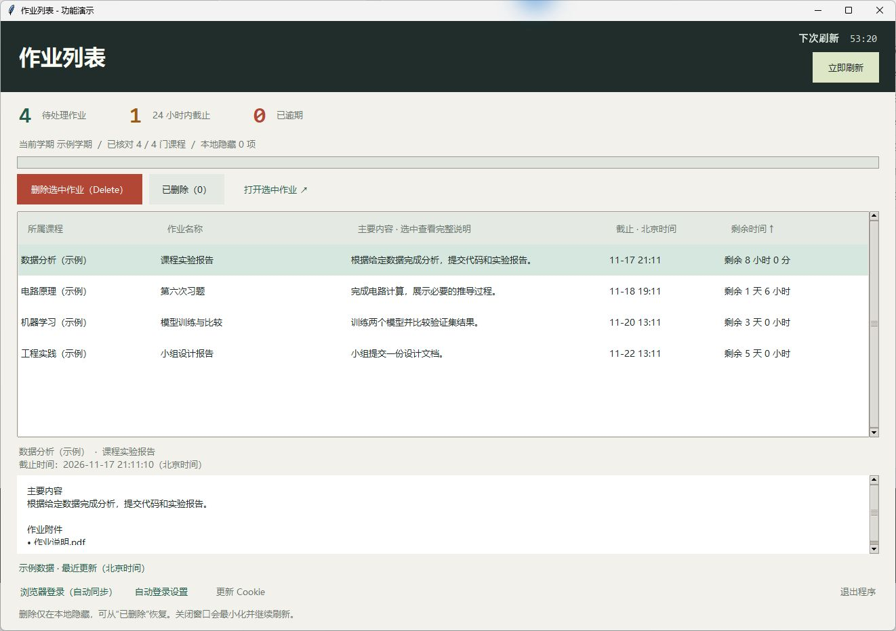
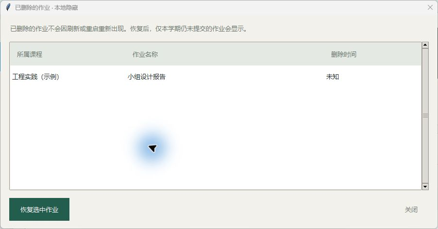

# netschool-undone_homework

清华大学网络学堂未交作业管理工具：常开的 Windows 桌面“作业列表”，每小时获取本学期全部课程的未提交作业，按距离截止时间从少到多排序。同时提供基于官方 TypeScript SDK 的本地 stdio MCP 服务，可接入 Claude Code 等客户端。

MCP 服务使用网络学堂 Cookie。Windows 桌面程序可以手动接收 Cookie、通过独立浏览器同步会话，或使用用户主动保存的本地加密账号重新登录。网络学堂接口属于站内接口，网站更新后可能需要调整适配。

## 界面预览

以下截图使用虚构课程和作业数据。

作业列表显示课程、内容、截止时间和剩余时间，选中一项后可查看详细说明。



本地隐藏的作业可在“已删除”窗口中恢复。



## 功能

| 功能 | 具体行为 |
| --- | --- |
| 本学期作业汇总 | 从服务器获取当前学期及全部课程，逐课程查询未提交作业 |
| 截止时间排序 | 剩余时间升序；逾期未交作业在最前，未知时间在末尾 |
| 课程和主要内容 | 显示所属课程、标题、正文摘要；选中后查看完整文字说明及题目附件名称 |
| 小组作业本地删除 | 小组成员已代交、本人无需再交时，本地隐藏对应作业；刷新和重启后仍生效，可恢复 |
| 常开窗口 | 首次启动立即刷新，以后每小时一次；最小化或点击右上角关闭后继续运行 |
| 登录会话维护 | 每十分钟检查并同步会话。保存加密账号后，会话失效时可在后台通过统一身份认证重新登录 |
| 操作入口 | “立即刷新”“自动登录设置”“浏览器登录（自动同步）”和“更新 Cookie” |
| 异常处理 | 每个读取进程请求间隔至少一秒；读取失败最多重试两次；失败时保留旧数据并提示 |
| MCP 工具 | 查询课程、作业状态和详情，下载题目附件，上传并提交作业 |

**桌面程序只读网络学堂，本地“删除”不改变网站上的作业或提交状态。** MCP 的 `submit_homework` 是独立写入能力，桌面窗口不会调用它。

## 两种使用方式

| 方式 | 适合场景 | 依赖 |
| --- | --- | --- |
| 桌面“作业列表” | 日常查看、倒计时、小组作业隐藏 | Windows、Node.js、Python（含 Tkinter） |
| stdio MCP 服务 | 通过支持 MCP 的客户端查询、管理作业 | Node.js、支持本地 stdio 的 MCP 客户端 |

MCP 不依赖 Python。桌面界面仅使用 Python 标准库，后台复用 TypeScript 服务层，无需额外安装 Python 包。目前桌面安装脚本和单实例机制面向 Windows。

## Windows 桌面版安装

### 1. 安装运行环境

- Git：用于克隆和更新，也可以下载 GitHub ZIP 后解压。
- Node.js **22.18 或更高版本**，包含 npm。
- Python **3.11**，安装时包含 Tcl/Tk；此版本已测试。

在 PowerShell 中检查：

```powershell
git --version
node --version
npm --version
py -3.11 -c "import tkinter; print('Tk', tkinter.TkVersion)"
```

没有 `py` 命令时可以使用 Python 的完整路径。`No module named tkinter` 表示需要通过 Python 安装器补装 Tcl/Tk。

### 2. 下载并构建

将项目放在之后会保留的位置；桌面快捷方式依赖此目录中的后台代码。

```powershell
git clone https://github.com/123huangcan250/netschool-undone_homework.git
cd netschool-undone_homework
npm ci
npm run build
```

`npm ci` 按锁文件安装依赖，`npm run build` 生成 `dist`。仓库不提交 `node_modules` 和 `dist`，首次克隆后必须执行这两步。

### 3. 选择登录方式

**桌面程序自动登录。** 先按下一步创建完整本地配置，`cookie` 可保持空字符串。安装后点击底部“自动登录设置”，在程序内填写清华统一身份认证账号和密码并加密保存。程序使用独立的 Chrome／Edge 用户目录。也可通过“浏览器登录（自动同步）”在独立窗口手动认证。需要已安装 Chrome 或 Edge，无需下载额外浏览器。

如果希望继续使用手动方式：

1. 打开 [清华大学网络学堂](https://learn.tsinghua.edu.cn/)，正常完成统一身份认证，进入自己的课程主页。
2. 按 **F12** 或 **Ctrl + Shift + I**，在开发者工具选择 **Network／网络**。
3. 保持开发者工具打开，刷新主页，选择一个域名为 **learn.tsinghua.edu.cn**、已正常返回课程或作业内容的请求。
4. 打开 **Headers／标头 → Request Headers／请求标头 → Cookie**，复制该字段的完整值。
5. 复制的内容应类似 `name=value; another=value`。只复制值，不带 `Cookie:` 前缀，不使用响应 `Set-Cookie`、统一认证域的 Cookie 或完整 cURL 命令。

Cookie 等同于当前会话的访问凭据，只保存在自己的本地配置中，不要放进 Issue、截图、聊天或 Git 提交。

### 4. 创建本地配置

在项目根目录执行。已有配置时不会覆盖：

```powershell
if (!(Test-Path -LiteralPath "config/local.json")) {
    Copy-Item -LiteralPath "config/example.json" -Destination "config/local.json"
}
notepad "config/local.json"
```

选择自动同步时，`cookie` 可保持 `""`；选择手动方式时只修改它的值，其余字段先保持默认。以下是重点字段，**不是完整配置文件**：

```json
{
  "cookie": "",
  "semesterId": null,
  "csrfToken": null,
  "timezone": "Asia/Shanghai",
  "requestIntervalMs": 1000
}
```

完整配置请从 [config/example.json](config/example.json) 复制，不要用上面的片段覆盖整个文件。`csrfToken` 留为 `null`，由服务从该会话主页读取；字符串里的双引号和反斜杠需要按 JSON 规则转义。

### 5. 安装到桌面并启动

在项目根目录执行：

```powershell
powershell -NoProfile -ExecutionPolicy Bypass -File .\desktop-app\install.ps1 -Launch
```

`ExecutionPolicy` 只作用于本次 PowerShell 进程，不修改系统持久配置。安装后生成：

```text
桌面/
├── 作业列表.lnk                双击启动
└── 作业列表程序/
    ├── homework_app.pyw        界面程序
    ├── fetch-homework.mjs      后台读取程序
    ├── browser-login.mjs       独立登录入口
    ├── browser-session.mjs     浏览器会话同步
    ├── session-cookie.mjs      Cookie 过滤和保存
    ├── refresh-errors.mjs      分类错误提示
    ├── app-settings.json       原项目、配置、Node.js 的路径
    ├── README.md
    └── data/                  运行后生成的个人缓存和偏好
```

如果自动查找不到环境，可明确指定路径：

```powershell
powershell -NoProfile -ExecutionPolicy Bypass -File .\desktop-app\install.ps1 -NodePath "C:\Program Files\nodejs\node.exe" -PythonPath "C:\Python311\pythonw.exe" -Launch
```

路径替换成自己的实际位置。`-PythonPath` 应指向 **pythonw.exe**，避免启动时出现额外命令行窗口。脚本默认先寻找当前用户目录下的 Python 3.11，再查找 PATH 中的 `pythonw.exe`。

首次安装打开程序后，点击底部“自动登录设置”，填写统一身份认证账号和密码并选择“加密保存”。如果学校要求验证码或额外验证，点击“浏览器登录（自动同步）”，在窗口中完成认证。首次刷新会读取课程、列表和正文，窗口显示进度；缓存已有数据时会先展示缓存。

## 桌面窗口怎么用

### 查看课程与主要内容

列表显示“所属课程”“作业名称”“主要内容”“截止时间”“剩余时间”。选中一行，下方展示课程、完整标题、截止时间、作业文字说明及附件名称。正文区支持滚动和复制。

摘要直接截取教师原文，不是模型生成的总结。仅有附件的作业显示附件名称；程序不下载或解析 PDF／Word 里的题目。点击“打开选中作业”或双击该行，在默认浏览器查看原网页和附件；浏览器也需要有效登录状态。

界面时间采用**北京时间（UTC+8）**。剩余时间在本地持续更新，不会每秒请求服务器。逾期与是否提交是独立状态，逾期未交作业仍保留在列表。

### 删除小组内已由别人提交的作业

1. 选中对应作业，核对课程和标题。
2. 点击**列表上方左侧红色“删除选中作业（Delete）”**，或在列表获得焦点时按 **Delete** 键。
3. 作业从本地待处理列表移出，顶部计数同步变化。

删除按“课程 ID ＋ 学生作业 ID”记录，不会因为标题相同误删其他课程的作业。记录保存在 `data/hidden.json`，刷新和重启后仍然生效。

点击旁边的**“已删除”**，选中一项或多项，再点击**“恢复选中作业”**。只恢复到当前学期仍未提交的作业列表；已经提交或不属于当前学期的项目不会被重新加入。恢复后若没有正文，点击“立即刷新”。

程序不会自动判断某位组员是否已交，也不把本地隐藏伪装成网站“已提交”。能否不交，需要按教师的小组要求自行决定。

### 刷新、常开与退出

- 首次启动立即刷新，以后每小时一次；顶部显示倒计时。
- “立即刷新”提前读取，完成操作后按本次刷新开始时间重新计算一小时间隔；不会重叠发起多轮刷新。
- 最小化和右上角关闭按钮会保留运行，可从任务栏恢复窗口。
- 底部**“退出程序”**才会停止；双击桌面快捷方式重新启动。
- 重复启动会提示已有实例，避免重复请求。
- 关机、休眠期间无法读取；恢复运行后会补做已到期的一轮刷新。程序不改变电源设置，不自动注册开机启动。

### 登录过期与异常

点击底部**“浏览器登录（自动同步）”**，在独立窗口手动完成认证，程序验证课程接口后自动同步 Cookie 并刷新作业。若现有 Cookie 仍有效，也可直接用于建立此独立会话。

启用后每十分钟检查一次课程接口，作业仍每小时刷新。失效时先尝试恢复独立浏览器会话。仍需登录时，程序才读取“自动登录设置”中加密保存的账号，通过清华统一认证表单登录，并在课程接口验证成功后写入新 Cookie。遇到验证码或额外验证，请点击“浏览器登录”手动完成一次。一次密码提交未确认成功时，程序会暂停重复提交。

手动获取新 Cookie 后，可点击**“更新 Cookie”**。这样会重置独立浏览器会话设置。若已保存自动登录账号，它仍可在下次需要时使用，可在“自动登录设置”清除。两种方式都更新原项目的 `config/local.json` 并清空旧固定 CSRF 值。独立运行的 MCP 服务需要重启以读取更新后的配置。

读取失败时保留旧列表，并提示本次尚未更新；单门课程失败会标记该课程旧数据，正文失败会保留已有正文并说明来源。不要把“读取失败”理解成“没有作业”。

## 本地文件与路径

| 文件 | 内容 |
| --- | --- |
| 项目 `config/local.json` | Cookie、超时、限速、MCP 提交限制；不提交到 Git |
| 项目 `config/protocol.json` | 内部接口 URL、字段及 HTML 选择器 |
| 桌面程序 `app-settings.json` | 项目目录、原配置路径、Node.js 路径和刷新周期；不含 Cookie |
| 桌面程序 `data/cache.json` | 最近课程和作业正文，含个人课程信息 |
| 桌面程序 `data/hidden.json` | 本地删除记录，独立于服务器刷新结果 |
| 桌面程序 `data/status.json` | 进程、刷新状态、计数、界面布局检查信息 |
| 桌面程序 `data/instance.lock` | 单实例文件锁，进程结束后由系统释放 |
| 桌面程序 `data/browser-profile/` | 本程序的独立浏览器用户目录，可能包含敏感登录状态，不可共享或提交 Git |
| 桌面程序 `data/browser-session.json` | 自动同步是否启用、浏览器类型和最近同步时间；不含 Cookie 值 |
| 桌面程序 `data/credentials.dpapi` | Windows DPAPI 加密后的账号和密码。通常需原 Windows 用户在原电脑上解密 |
| 项目 `.state/` | 提交回执或本地真实联调记录，不提交到 Git |

桌面设置结构见 [settings.example.json](desktop-app/settings.example.json)。刷新周期默认 `3600` 秒，小于一小时的值会提升为一小时。桌面始终使用服务器当前学期，MCP 则尊重 `semesterId` 配置。

请保留原项目和依赖。移动项目或 Node.js 后，修改桌面的 `app-settings.json` 路径，或先退出程序、再从新位置重跑安装脚本。卸载时先退出，再删除桌面快捷方式和“作业列表程序”文件夹；需要保留隐藏记录时先备份 `data/hidden.json`。

## 更新程序

先在窗口底部点击“退出程序”，再在**原项目根目录**执行：

```powershell
git pull --ff-only
npm ci
npm run build
powershell -NoProfile -ExecutionPolicy Bypass -File .\desktop-app\install.ps1 -Launch
```

如果首次安装使用了自定义 `-NodePath`、`-PythonPath`，更新安装时也传入相同参数。安装脚本会更新桌面的界面与读取脚本，保留 `data` 中的缓存和删除记录；`git pull` 本身不会更新桌面副本。`config/local.json` 留在本地，不要重新用空白示例覆盖。使用 MCP 的客户端还需要重启该服务。

## MCP 接入

只使用 MCP 时，完成 `npm ci`、Cookie 配置和 `npm run build` 即可，不需要 Python 或桌面安装。

### Claude Code

替换为两个实际**绝对路径**后执行：

```powershell
claude mcp add --transport stdio --scope user thu-learn -- node "C:\Projects\netschool-undone_homework\dist\index.js" --config "C:\Projects\netschool-undone_homework\config\local.json"
```

在 Claude Code 中运行 `/mcp` 检查连接。语法依据 [Claude Code 官方 MCP 文档](https://code.claude.com/docs/en/mcp#option-3-add-a-local-stdio-server)。

### 其他 stdio 客户端

```json
{
  "mcpServers": {
    "thu-learn": {
      "command": "node",
      "args": [
        "C:/Projects/netschool-undone_homework/dist/index.js",
        "--config",
        "C:/Projects/netschool-undone_homework/config/local.json"
      ]
    }
  }
}
```

客户端找不到 `node` 时，将 `command` 改成 `node.exe` 的绝对路径。手动运行 `node dist/index.js` 后没有欢迎文字是正常现象：stdio 服务等待客户端协议消息，标准输出仅供 MCP 使用。

| 工具 | 参数 | 返回 |
| --- | --- | --- |
| `get_course_list` | 无 | 学期、课程 ID、名称、教师 |
| `get_homework_list` | `courseId` | 三种状态合并列表；ISO 8601 时间、剩余秒数、成绩与提交状态 |
| `get_homework_detail` | `homeworkId` | 正文、附件、时间节点、提交要求、已提交内容 |
| `download_homework_attachment` | `homeworkId`、`attachmentIndex`、`destinationPath` | 下载详情中的附件到本机，返回路径、大小与 SHA-256 |
| `submit_homework` | `homeworkId`、`filePath` 或 `filePaths`、可选 `remarks` | 上传并提交、状态核验、本地回执 |

可以向客户端提出：“列出本学期三天内截止且尚未提交的作业，显示课程、主要内容和北京时间截止日期。”

`homeworkId` 使用学生作业 ID（`xszyid`），不要与教师作业 ID（`zyid`）混用。桌面隐藏记录不影响 MCP 查询，MCP 仍返回网站原始状态。

获取作业文件时，先调用 `get_homework_detail`，根据返回的 `attachments` 数组选择附件。数组第一项的 `attachmentIndex` 为 0，`role: assignment` 表示教师提供的作业附件。再调用 `download_homework_attachment`，传入该作业 ID、序号和本机绝对文件路径。目标目录须存在，目标文件不能已存在，单个附件限 100 MiB。支持通过 MCP 客户端请求“读取这份作业的要求并下载教师附件到指定目录”。下载后可使用支持对应格式的本地工具读取文件。

提交需明确指定作业和本地文件，遵守允许目录、截止时间、大小及格式限制。多文件通过当前单附件协议打包为 ZIP；课程只允许 PDF 时会拒绝 ZIP。提交可能替换已有附件和正文。2026 年 11 月已验证两份真实作业的提交和状态核验，不代表覆盖所有课程的提交形式。详细配置、参数、错误返回和幂等回执见 [MCP 使用说明](docs/MCP.md) 和 [工具 Schema](docs/tools.json)。

## 常见问题

| 现象 | 处理 |
| --- | --- |
| `AUTH_REQUIRED`／登录失效 | 重新登录并更新网络学堂 Cookie；浏览器登录态不会自动同步给 Node.js |
| `CSRF_INVALID` | 更新同一有效会话的 Cookie，保持 `csrfToken: null`；MCP 服务重启 |
| `CONFIG_ERROR` | 使用完整示例配置，确认 JSON 和路径有效，Cookie 不含前缀或换行 |
| 找不到 Node.js／Python | 检查路径，用安装脚本参数明确指定 |
| 找不到 `dist/learn.js`／`dist/index.js` | 项目根目录执行 `npm ci`、`npm run build` |
| 只显示旧结果 | 检查刷新提示、网络和 Cookie；缓存不表示本次成功 |
| 删除按钮在哪 | 列表上方左侧红色按钮，先选中一行；也支持列表中的 Delete 键 |
| 删除后刷新仍不出现 | 持久化隐藏的预期行为，在“已删除”恢复 |
| 正文为空或“见附件” | 展示的是教师原文，打开原网页查看附件 |
| 关闭后程序还在 | 关闭按钮会最小化；底部“退出程序”停止 |
| 再次双击没新窗口 | 已有实例在运行，从任务栏恢复 |
| `PROTOCOL_CHANGED` | 可能是网页或接口变化，按 [API 文档](docs/API.md) 检查协议和解析器 |
| `SUBMISSION_UNCERTAIN` | 先核对原网页真实结果，不要删除回执后反复提交 |

## 开发与测试

```powershell
npm ci
npm run check
py -3.11 desktop-app/test_homework_app.py
```

Node.js 测试使用合成数据、模拟服务和真实 stdio 子进程。桌面测试使用测试窗口，验证删除／恢复与持久化、课程区分、正文缓存、每小时调度、不同窗口尺寸与字体缩放下的按钮可见性，需要 Windows 和 Tkinter。以上测试无需校园账号，不上传真实作业。

| 命令 | 用途 |
| --- | --- |
| `npm run build` | 编译到 `dist` |
| `npm test` | Node.js 测试；stdio 子进程测试要求已有 `dist` |
| `npm run check` | 构建并测试 |
| `npm run probe -- --config config/local.json` | 有效 Cookie 的只读接口探测 |
| `npm run test:live -- --config config/local.json --course COURSE_ID` | 真实 stdio MCP 只读联调；替换为真实课程 ID |
| `npm run export-tools` | 重新生成 `docs/tools.json` |
| `npm run package` | 生成排除 Cookie、缓存和依赖的交付 ZIP |

```text
src/                 MCP、会话、接口、解析和提交服务
desktop-app/         Tk 界面、Node.js 读取程序、Windows 安装脚本
config/              空白配置示例和协议定义；local.json 仅留本地
test/                Node.js 测试及匿名表单
scripts/             只读探测、真实联调、工具导出和打包
docs/                API、MCP 用法、脱敏验证记录
evaluations/         合成只读评估集
submissions/         默认允许的本地提交目录，实际文件不提交 Git
```

当前在 Windows 本地通过 **48 项 Node.js 测试和 10 项桌面测试**。2026 年 11 月 17 日通过 stdio MCP 读取课程及作业详情、下载教师附件，并完成两份作业的真实提交核验。历史脱敏记录见 [浏览器测试](docs/LIVE_BROWSER_TEST.md)、[MCP 测试](docs/LIVE_MCP_TEST.md) 和 [验证说明](docs/VALIDATION.md)。

依赖与第三方参考见 [DEPENDENCIES.md](DEPENDENCIES.md)、[THIRD_PARTY_NOTICES.md](THIRD_PARTY_NOTICES.md)。反馈问题时请提供已移除个人数据的错误码、复现步骤和最小样本，不要上传 Cookie、原始 HAR、个人作业附件或本地 `data` 文件夹。
